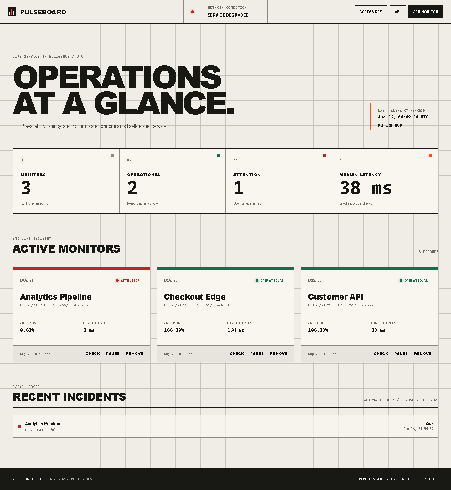
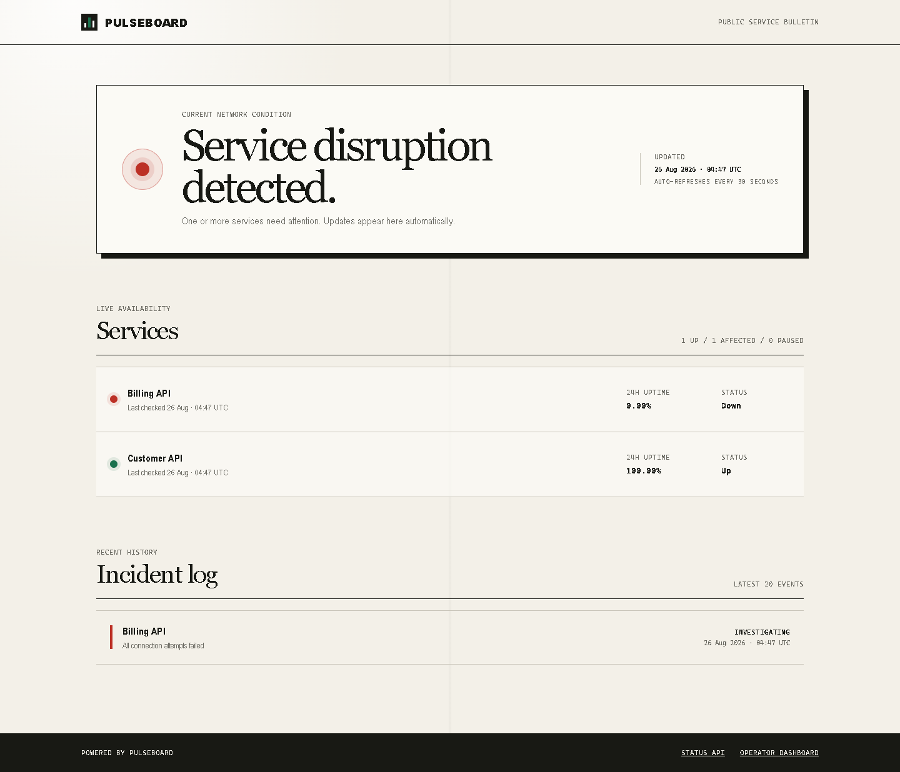

# Pulseboard

[](https://github.com/kyan9400/pulseboard/actions/workflows/ci.yml)
[](https://www.python.org/)
[](Dockerfile)
[](LICENSE)

A compact, self-hosted HTTP uptime monitor with incident history, an operations dashboard, a public status page, and a small deployment footprint.



Pulseboard checks public HTTP endpoints on a schedule, records latency and availability in SQLite, and opens or resolves incidents automatically. It exposes the same state through a responsive dashboard, a typed JSON API, health probes, and Prometheus-compatible metrics.

## Why Pulseboard

- **Useful in one container:** the scheduler, API, dashboard, and database work without external services.
- **Operationally legible:** current state, 24-hour availability, latest latency, and incident recovery are visible at a glance.
- **Safe outbound defaults:** private and reserved networks are blocked, credentials are rejected, and redirects are not followed.
- **Protected writes:** set one environment variable to require an API key for create, update, check, and delete operations.
- **Observable itself:** liveness, readiness, and metrics endpoints are included.
- **Ready for customers:** `/status` publishes a responsive, read-only service bulletin without exposing monitored URLs.



## Run with Docker

```bash
git clone https://github.com/kyan9400/pulseboard.git
cd pulseboard
docker compose up --build -d
```

Open [http://localhost:8000](http://localhost:8000). The named Docker volume keeps the SQLite database across container replacements.

For a network-accessible deployment, set a write key first:

```bash
PULSEBOARD_API_KEY="replace-with-a-long-random-value" docker compose up --build -d
```

Enter the same value under **Access key** in the dashboard. It stays in the browser tab's session storage.

## Run from Python

```bash
python -m venv .venv
source .venv/bin/activate
python -m pip install -e .
pulseboard
```

On Windows, activate with `.venv\Scripts\activate`.

## Configuration

All settings use the `PULSEBOARD_` prefix.

| Variable | Default | Purpose |
| --- | --- | --- |
| `DATABASE_URL` | `sqlite+aiosqlite:///./pulseboard.db` | SQLAlchemy async database URL |
| `API_KEY` | unset | Require `X-API-Key` on write routes |
| `ALLOW_PRIVATE_TARGETS` | `false` | Permit private and loopback monitoring targets |
| `ENABLE_SCHEDULER` | `true` | Run scheduled checks in the application process |
| `SCHEDULER_TICK_SECONDS` | `5` | Frequency for scanning due monitors |
| `CHECK_CONCURRENCY` | `8` | Maximum concurrent outbound checks |
| `MAX_CHECKS_PER_MONITOR` | `1000` | Retained check records per endpoint |

Use `PULSEBOARD_ALLOW_PRIVATE_TARGETS=true` only when Pulseboard runs on a trusted network and must check internal services.

## HTTP surface

| Endpoint | Purpose |
| --- | --- |
| `GET /status` | Public, auto-refreshing service status page |
| `GET /api/status` | Public operational summary |
| `GET /api/monitors` | Monitor state and 24-hour availability |
| `POST /api/monitors` | Create a validated monitor |
| `POST /api/monitors/{id}/checks` | Run an immediate check |
| `GET /api/incidents` | Recent open and resolved incidents |
| `GET /metrics` | Prometheus-compatible gauges |
| `GET /health/live` | Process liveness |
| `GET /health/ready` | Database readiness |

Interactive API documentation is available at `/docs` in local mode and disabled when `PULSEBOARD_ENVIRONMENT=production`.

## Architecture

```text
Browser / API client
        │
        ▼
FastAPI ───── dashboard + JSON API + health + metrics
   │
   ├──── async scheduler ─── bounded HTTP checks
   │                              │
   ▼                              ▼
SQLite                    public endpoints
monitors / checks / incidents
```

The built-in scheduler is intentionally designed for a single application worker. For a horizontally scaled deployment, disable it and run a dedicated scheduler instance.

## Development

```bash
python -m pip install -e ".[dev]"
ruff check .
ruff format --check .
pytest
docker build -t pulseboard .
```

The test suite uses an in-memory HTTP transport, so it does not contact external services.

## License

[MIT](LICENSE)
